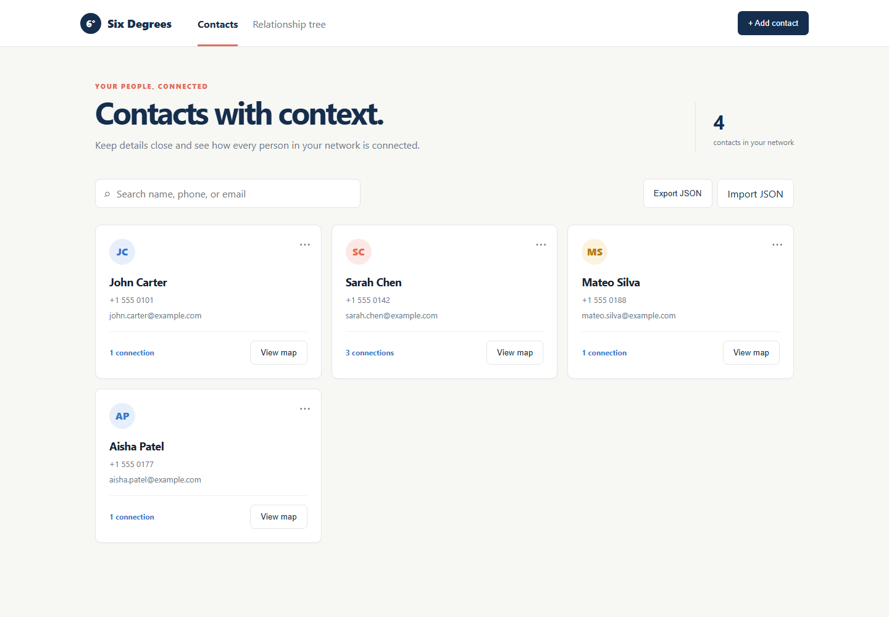
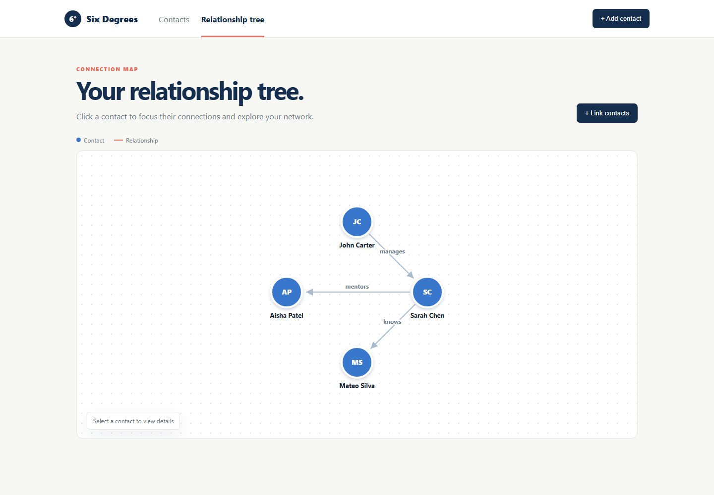

# Six Degrees — Contact Management System

A polished, dependency-free contact manager that makes relationships visible. Add people, maintain contact details, link contacts with a relationship label, and explore the resulting network.

## Run it

Open `index.html` in a current web browser. For the most reliable local experience, serve this folder with a static-server extension (such as VS Code Live Server) and open the supplied local URL. No package installation is required.

## Features

- Create, list, edit, and delete contacts.
- Required full name, phone, and email fields with JavaScript email-format and phone-digit validation.
- Prevents duplicate phone numbers and email addresses.
- Instant search by name, phone, or email.
- Build directed, labeled links such as “John manages Sarah”; arrows show the relationship direction from the first contact to the second.
- Visual relationship network; select a node to focus its connection count.
- Persists automatically across browser restarts and supports JSON export/import.

## Storage format

The app stores data under the browser `localStorage` key `six-degrees-contacts-v1`. It is JSON in this shape:

```json
{
  "contacts": [{ "id": "c1", "name": "John Carter", "phone": "+1 555 0101", "email": "john.carter@example.com" }],
  "links": [{ "id": "l1", "from": "c1", "to": "c2", "label": "manages" }]
}
```

The initial sample data includes John Carter, Sarah Chen, Mateo Silva, and Aisha Patel. It demonstrates John → Sarah (`manages`), Sarah → Mateo (`knows`), and Sarah → Aisha (`mentors`).

## Brief demo flow

1. On **Contacts**, use **Add contact**, complete the three required fields, and save.
2. Use the search field to filter by a contact detail; open the `⋯` menu to edit or delete a record.
3. Open **Relationship tree**, choose **Link contacts**, select both people, and write a relationship.
4. Click a node in the tree to inspect that contact’s relationship count. Use **Export JSON** to create a portable backup.

## Screenshots

The committed screenshots show the supplied sample data and the relationship visualization:




